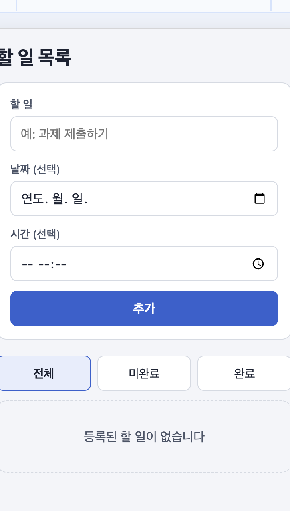
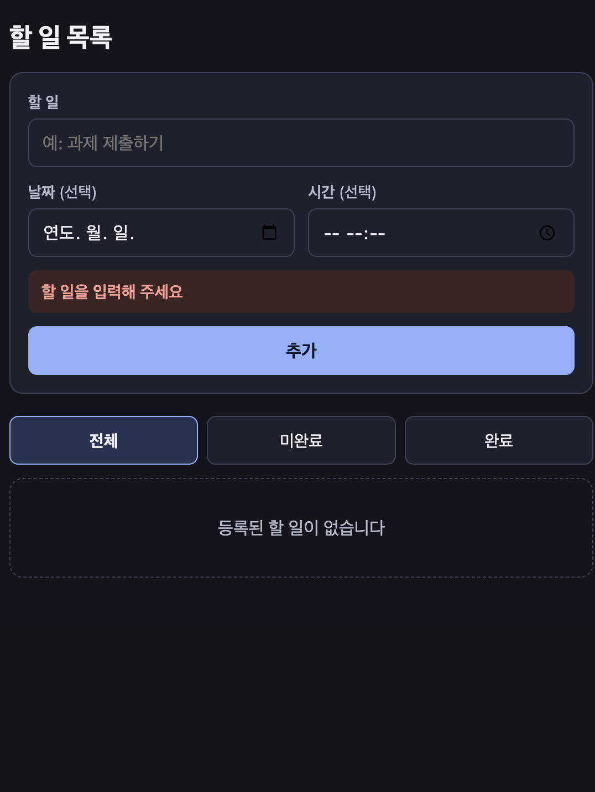
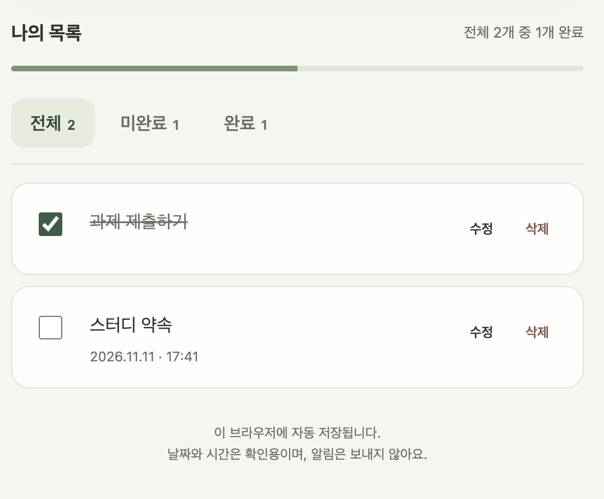
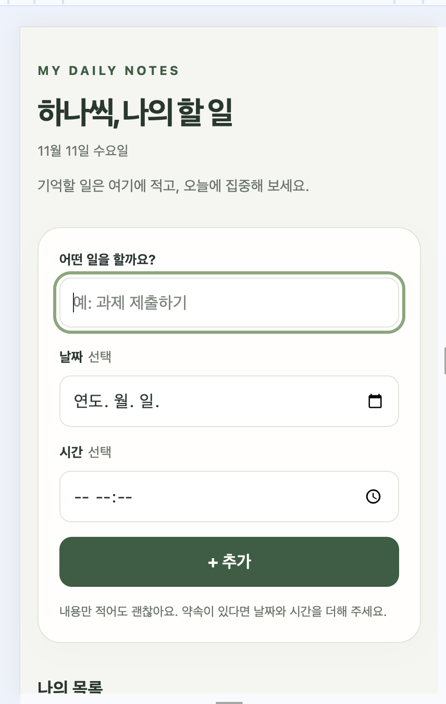
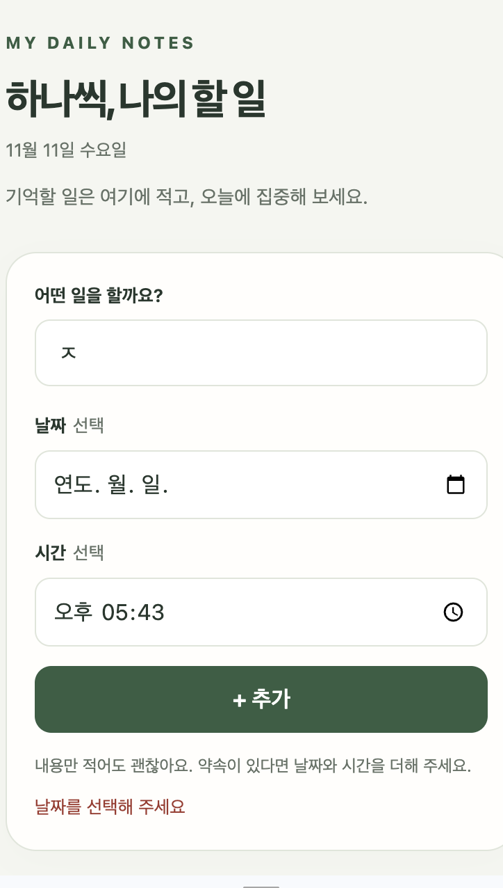

# 제작·검증 기록: 학생을 위한 To-do list

## 두 AI 비교

- AI A (서비스·모델 이름): ChatGPT, ChatGPT 6.1 Sol medium → `할일목록_v1.html`
- AI B (서비스·모델 이름): Claude Code, Claude Fable 5.2 → `할일목록_v2.html`
- 동일한 기획서와 함께 전달한 요청: “폴더 2-1에 있는 할일목록/기획서.md 파일을 보고 HTML 파일을 만들어봐 

| 테스트 내용 | AI A | AI B |
| --- | --- | --- |
| 기획서의 완료 기준과 검증 방법대로 추가·완료 체크·보기 전환·수정·삭제 해 보기 | 모두 기획서대로 동작함 | 모두 기획서대로 동작함 |
| 날짜 없이 시간만 넣고 ‘추가’ 누르기 | 추가되지 않고 ‘날짜를 선택해 주세요’가 나옴 | 추가되지 않고 ‘날짜를 선택해 주세요’가 나옴 |
| 화면에 기획서에 적힌 것만 있는지 보기 | 기획서에 없는 진행률 막대, 보기별 개수, 오늘 날짜, 소개 문구, 바닥글이 있음. 버튼 이름도 ‘추가’가 아니라 ‘+ 추가’임 | 기획서에 적힌 요소만 있음. 저장이 안 될 때 나오는 안내 한 줄만 추가됨 |
| 남은 일과 끝낸 일이 몇 개인지 한눈에 보기 | ‘전체’, ‘미완료’, ‘완료’ 버튼 옆에 개수가 보이고, ‘전체 2개 중 1개 완료’ 문구와 완료율 막대가 항상 보임 | 개수 표시가 없어서 보기를 바꿔 가며 직접 세어야 함 |
| Mac을 다크 모드로 바꾸고 열기 | 밝은 화면 그대로임 | 어두운 화면으로 바뀜 |
| 화면 낭독기 알림이 있는지 코드 보기 | 추가·수정·삭제·완료 체크를 하면 ‘할 일을 추가했습니다’ 같은 문장을 낭독기에 알리는 코드가 있음 | 알림 코드가 없음 |
| 코드를 읽고 고치기 쉬운지 보기 | 한 줄에 길게 붙어 있는 71줄이라 읽기 어려움 | 줄바꿈과 주석이 있는 591줄이라 읽기 쉬움 |

- 선택한 결과물과 근거: A(`할일목록_v1.html`)를 골랐습니다. 완료 기준과 검증 방법은 A와 B가 모두 충족해서 그것만으로는 둘을 가릴 수 없었습니다. 그래서 다음 세 가지를 보고 A로 정했습니다.
  - 전체·미완료·완료 개수와 완료율이 항상 보여서, 남은 일을 확인한다는 이 페이지의 사용 목적에 더 잘 맞습니다.
  - 화면 낭독기 알림이 있어서 화면을 보기 어려운 사람도 쓸 수 있습니다.
  - 색과 배치가 시각적으로 더 보기 좋았습니다.
- B가 더 나았던 점: 기획서에 적힌 것만 있는지로 보면 B가 기획서를 더 잘 지켰습니다. 다크 모드를 지원하는 것과 코드를 고치기 쉬운 것도 B가 나았습니다. 그래도 개수 표시와 낭독기 알림이 페이지를 쓰는 사람에게 더 중요하다고 판단했습니다.
- 선택하지 않은 B의 결과는 위 표의 설명과 아래 화면 캡처로 남깁니다. `할일목록_v2.html` 파일은 제출하지 않습니다.

## 테스트 기록

선택한 `할일목록_v1.html`을 테스트한 기록입니다.

| 번호 | 테스트 내용 | 예상 결과 | 실제 결과 |
| --- | --- | --- | --- |
| 1 | 날짜 없는 ‘과제 제출하기’와 날짜·시간이 있는 ‘스터디 약속’을 차례로 추가하기 | 두 항목이 미완료로 목록에 추가됨. ‘과제 제출하기’에는 날짜가 보이지 않고, ‘스터디 약속’에는 입력한 날짜·시간이 보임. 버튼 이름은 기획서대로 ‘추가’ | 두 항목이 예상한 대로 추가되고 날짜·시간도 입력한 값과 같았음. 예상과 다른 점: 버튼 이름이 ‘추가’가 아니라 ‘+ 추가’로 보임 |
| 2 | 두 항목 중 하나만 완료 체크한 뒤 ‘전체’, ‘미완료’, ‘완료’를 차례로 누르기 | 체크한 항목에 취소선이 생기고 글씨가 흐려짐. 전체 2개, 미완료 1개, 완료 1개가 보임 | 예상한 대로 2개, 1개, 1개가 보임. 예상과 다른 점: 기획서에 없는 보기별 개수와 ‘전체 2개 중 1개 완료’ 문구, 완료율 막대가 함께 보임 |
| 3 (빈 입력값으로 조건을 바꿔 테스트) | 내용을 비우고 ‘추가’ 누르기, 공백만 넣고 ‘추가’ 누르기, 날짜 없이 시간만 넣고 ‘추가’ 누르기 | 세 경우 모두 추가되지 않음. 앞의 두 경우는 ‘할 일을 입력해 주세요’, 마지막은 ‘날짜를 선택해 주세요’가 나옴 | 예상한 대로 추가되지 않고 안내 문구가 나옴 |
| 4 (좁은 화면으로 조건을 바꿔 테스트) | 화면 너비를 360px로 놓고 긴 할 일을 입력한 뒤 추가·체크·체크 취소·수정·삭제를 차례로 하기 | 가로 스크롤이나 내용 잘림 없이 긴 내용이 줄바꿈되고, 모든 버튼을 누를 수 있음 | 예상한 대로 가로 스크롤 없이 줄바꿈되고 모든 동작이 됨 |

