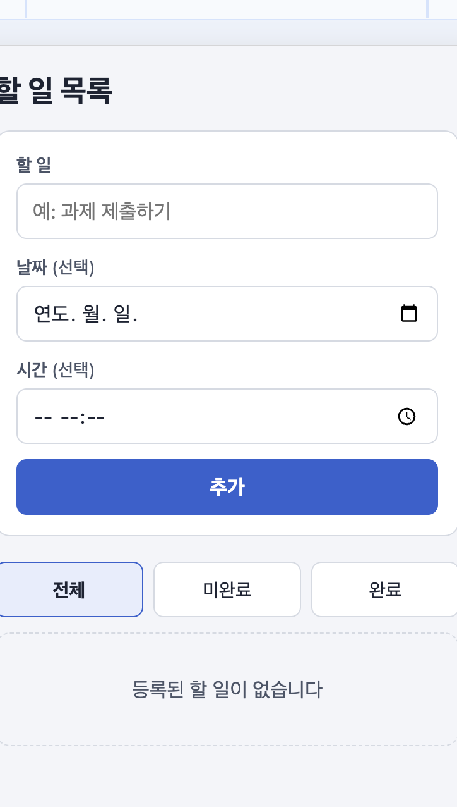
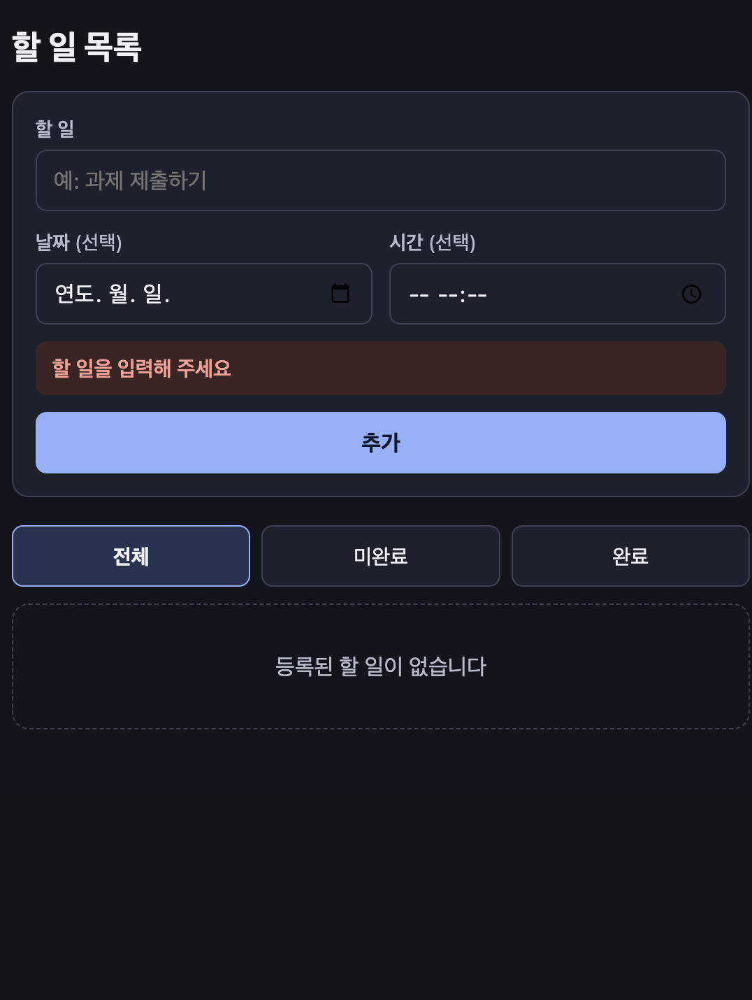
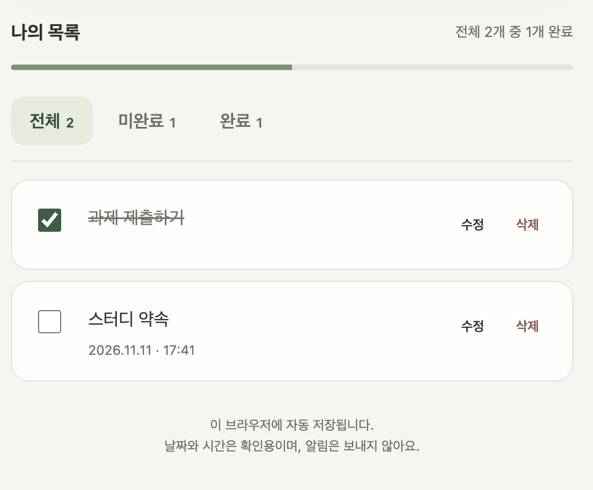
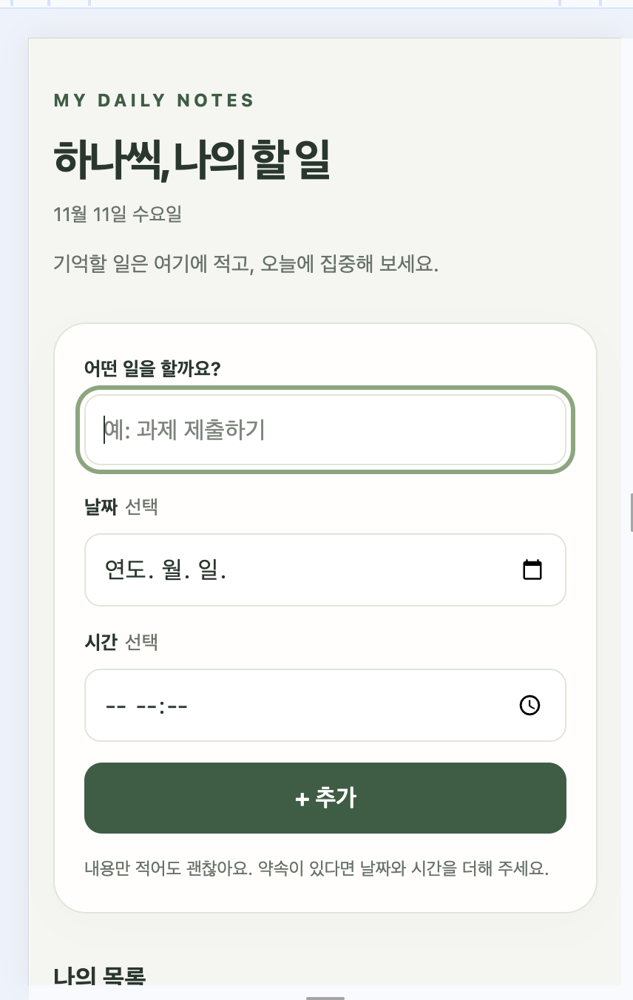
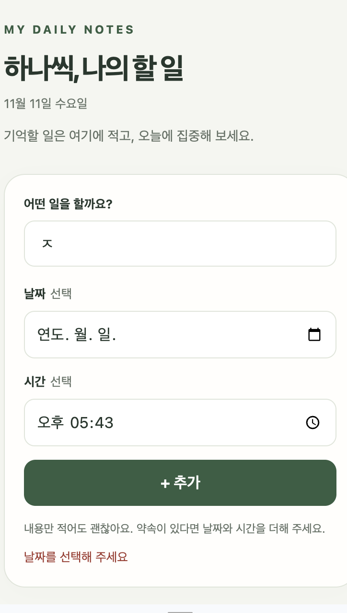

# 제작·검증 기록: 학생을 위한 To-do list

## 두 AI 비교

- AI A (서비스·모델 이름): ChatGPT, ChatGPT 6.1 Sol medium → `할일목록_v1.html`
- AI B (서비스·모델 이름): Claude Code, Claude Fable 5.2 → `할일목록_v2.html`
- 동일한 기획서와 함께 전달한 요청: “폴더 2-1에 있는 할일목록/기획서.md 파일을 보고 HTML 파일을 만들어봐”

| 테스트 내용 | AI A | AI B |
| --- | --- | --- |
| 기획서의 완료 기준과 검증 방법대로 추가·완료 체크·보기 전환·수정·삭제 해 보기 | 모두 기획서대로 동작함 | 모두 기획서대로 동작함 |
| 날짜 없이 시간만 넣고 ‘추가’ 누르기 | 추가되지 않고 ‘날짜를 선택해 주세요’가 나옴 | 추가되지 않고 ‘날짜를 선택해 주세요’가 나옴 |
| 화면에 기획서에 적힌 것만 있는지 보기 | 기획서에 없는 진행률 막대, 보기별 개수, 오늘 날짜, 소개 문구, 바닥글이 있음. 버튼 이름도 ‘추가’가 아니라 ‘+ 추가’임 | 기획서에 적힌 요소만 있음. 저장이 안 될 때 나오는 안내 한 줄만 추가됨 |
| 남은 일과 끝낸 일이 몇 개인지 한눈에 보기 | ‘전체’, ‘미완료’, ‘완료’ 버튼 옆에 개수가 보이고, ‘전체 2개 중 1개 완료’ 문구와 완료율 막대가 항상 보임 | 개수 표시가 없어서 보기를 바꿔 가며 직접 세어야 함 |
| Mac을 다크 모드로 바꾸고 열기 | 밝은 화면 그대로임 | 어두운 화면으로 바뀜 |
| 화면 낭독기 알림이 있는지 코드 보기 | 추가·수정·삭제·완료 체크를 하면 ‘할 일을 추가했습니다’ 같은 문장을 낭독기에 알리는 코드가 있음 | 알림 코드가 없음 |
| 코드를 읽고 고치기 쉬운지 보기 | 한 줄에 길게 붙어 있는 71줄이라 읽기 어려움 | 줄바꿈과 주석이 있는 591줄이라 읽기 쉬움 |

- 선택한 결과물과 근거: A(`할일목록_v1.html`)를 골랐습니다. 완료 기준과 검증 방법은 A와 B가 모두 충족해서 그것만으로는 둘을 가릴 수 없었습니다. 그래서 다음 세 가지를 보고 A로 정했습니다.
  - 전체·미완료·완료 개수와 완료율이 항상 보여서, 남은 일을 확인한다는 이 페이지의 사용 목적에 더 잘 맞습니다.
  - 화면 낭독기 알림이 있어서 화면을 보기 어려운 사람도 쓸 수 있습니다.
  - 색과 배치가 시각적으로 더 보기 좋았습니다.
- B가 더 나았던 점: 기획서에 적힌 것만 있는지로 보면 B가 기획서를 더 잘 지켰습니다. 다크 모드를 지원하는 것과 코드를 고치기 쉬운 것도 B가 나았습니다. 그래도 개수 표시와 낭독기 알림이 페이지를 쓰는 사람에게 더 중요하다고 판단했습니다.
- 선택하지 않은 B의 결과는 위 표의 설명과 아래 화면 캡처로 남깁니다. `할일목록_v2.html` 파일은 제출하지 않습니다.

## 테스트 기록

선택한 `할일목록_v1.html`을 테스트한 기록입니다.

| 번호 | 테스트 내용 | 예상 결과 | 실제 결과 |
| --- | --- | --- | --- |
| 1 | 날짜 없는 ‘과제 제출하기’와 날짜·시간이 있는 ‘스터디 약속’을 차례로 추가하기 | 두 항목이 미완료로 목록에 추가됨. ‘과제 제출하기’에는 날짜가 보이지 않고, ‘스터디 약속’에는 입력한 날짜·시간이 보임. 버튼 이름은 기획서대로 ‘추가’ | 두 항목이 예상한 대로 추가되고 날짜·시간도 입력한 값과 같았음. 예상과 다른 점: 버튼 이름이 ‘추가’가 아니라 ‘+ 추가’로 보임. 수정 기록 2로 고친 뒤에는 ‘추가’로 보임 |
| 2 | 두 항목 중 하나만 완료 체크한 뒤 ‘전체’, ‘미완료’, ‘완료’를 차례로 누르기 | 체크한 항목에 취소선이 생기고 글씨가 흐려짐. 전체 2개, 미완료 1개, 완료 1개가 보임 | 예상한 대로 2개, 1개, 1개가 보임. 예상과 다른 점: 기획서에 없는 보기별 개수와 ‘전체 2개 중 1개 완료’ 문구, 완료율 막대가 함께 보임. 남은 일을 확인하는 데 도움이 되어 그대로 두고 기획서에 적음 |
| 3 (빈 입력값으로 조건을 바꿔 테스트) | 내용을 비우고 ‘추가’ 누르기, 공백만 넣고 ‘추가’ 누르기, 날짜 없이 시간만 넣고 ‘추가’ 누르기 | 세 경우 모두 추가되지 않음. 앞의 두 경우는 ‘할 일을 입력해 주세요’, 마지막은 ‘날짜를 선택해 주세요’가 나옴 | 예상한 대로 추가되지 않고 안내 문구가 나옴 |
| 4 (좁은 화면으로 조건을 바꿔 테스트) | 화면 너비를 360px로 놓고 긴 할 일을 입력한 뒤 추가·체크·체크 취소·수정·삭제를 차례로 하기 | 가로 스크롤이나 내용 잘림 없이 긴 내용이 줄바꿈되고, 모든 버튼을 누를 수 있음 | 예상한 대로 가로 스크롤 없이 줄바꿈되고 모든 동작이 됨 |
| 5 (잘못 입력한 뒤 고치는 조건으로 테스트) | 날짜 없이 시간만 넣고 ‘추가’를 눌러 ‘날짜를 선택해 주세요’가 나오게 한 뒤, 날짜를 고르기 | 날짜를 고르면 문제가 해결됐으므로 빨간 안내 문구가 사라짐 | 예상과 다름: 날짜를 골라도 ‘추가’를 다시 누르기 전까지 안내 문구가 그대로 남아 있음. 수정 기록 1로 고친 뒤에는 날짜를 고르는 즉시 사라짐 |

## 수정 기록

수정은 Claude Code(Claude Fable 5.2)에 요청했습니다. 한 번에 한 가지만 고치고 버전을 나누어 저장했으며, 고칠 때마다 이전에 되던 기능을 같은 순서로 다시 점검했습니다.

### 수정 기록 1

- 발견한 문제: 날짜 없이 시간만 넣고 ‘추가’를 누르면 ‘날짜를 선택해 주세요’가 나옵니다. 그 뒤 날짜를 고르면 안내가 사라질 줄 알았는데, ‘추가’를 다시 누르기 전까지 빨간 문구가 그대로 남아 있었습니다. 내용을 비우고 ‘추가’를 눌러 나온 ‘할 일을 입력해 주세요’도 내용을 적은 뒤까지 남아 있었습니다.
- AI에게 전달한 요청: “‘날짜를 선택해 주세요’가 나온 뒤 날짜를 골라도 ‘추가’를 다시 누르기 전까지 빨간 문구가 그대로 보여. 이 문제 하나만 고친 v2를 만들어 줘. 한 부분을 바꾸면 기존 기능에도 영향을 줄 수 있으니까, 이전에 정상적으로 동작하던 기능도 같이 점검해 줘. 버전을 나누어 저장해서 전후를 비교할 수 있게 해 줘.”
- 저장한 버전: `할일목록_v1.html` → `할일목록_v2.html`
- 수정 후 테스트 결과: 시간만 넣어 안내가 나온 상태에서 날짜를 고르거나 시간을 지우면 안내가 바로 사라졌습니다. 내용을 비워 나온 안내도 글자를 적으면 바로 사라지고, 공백만 적으면 그대로 남았습니다. 항목의 ‘수정’ 창에서도 같게 동작했습니다. 날짜 안내가 나온 상태에서 내용 칸만 고치면 날짜 문제는 그대로이므로 안내가 남아 있었습니다. 같은 순서로 v1을 해 보면 안내가 계속 남아 있어 전후 차이를 확인했습니다. 기존 기능인 추가·날짜 표시·완료 체크와 해제·보기 전환(2개·1개·1개, 해제 후 2개·2개·0개)·수정 저장과 취소·삭제·다시 열었을 때 복원도 v1과 같게 동작했습니다.
- 수정 이유: 잘못된 입력을 이미 고쳤는데 오류 문구가 남아 있으면, 아직 틀린 곳이 있다고 생각해 ‘추가’를 누르지 못하고 멈출 수 있습니다.

### 수정 기록 2

- 발견한 문제: 기획서에는 버튼 이름을 ‘추가’로 적었는데, 화면에는 ‘+ 추가’로 보였습니다(테스트 기록 1).
- AI에게 전달한 요청: “기획서에는 버튼 이름이 ‘추가’인데 화면에는 ‘+ 추가’로 보여. 버튼 이름만 ‘추가’로 바꾼 v3을 만들어 줘. 다른 기능은 그대로 두고, 이전에 되던 기능도 같이 점검해 줘.”
- 저장한 버전: `할일목록_v2.html` → `할일목록_v3.html`
- 수정 후 테스트 결과: 버튼이 ‘추가’로 보였고, 누르면 이전처럼 항목이 추가됐습니다. 360px 화면에서도 버튼이 화면 안에 들어왔습니다. 수정 기록 1에서 고친 안내 문구 동작과 추가·완료 체크·보기 전환·수정·삭제·다시 열었을 때 복원도 v2와 같게 동작했습니다.
- 수정 이유: 기획서와 화면의 버튼 이름이 다르면 기획서를 보고 검증할 때 같은 버튼인지 헷갈립니다.

### 수정 기록 3

- 발견한 문제: 사용자 테스트에서 날짜 없는 할 일과 날짜 있는 할 일을 추가한 뒤, 날짜 없는 할 일을 수정해 날짜를 넣었습니다. 날짜에 맞게 순서가 바뀔 줄 알았는데, 추가한 순서 그대로였습니다.
- AI에게 전달한 요청: “날짜 안 쓴 것과 날짜 쓴 것을 추가하고, 날짜 안 쓴 것을 수정하면 순서가 바뀌어야 하는데 안 바뀌어. 기획서에 추가 기능으로 적어 둔 날짜순 정렬을 구현한 v4를 만들어 줘. 다른 기능은 그대로 두고, 이전에 되던 기능도 같이 점검해 줘.”
- 저장한 버전: `할일목록_v3.html` → `할일목록_v4.html`
- 수정 후 테스트 결과: 날짜 없는 항목과 날짜 있는 항목을 차례로 추가하면 날짜 있는 항목이 위에 보였습니다. 날짜 없는 항목을 수정해 더 이른 날짜를 넣으면 위로 올라가고, 더 늦은 날짜로 바꾸면 아래로 내려갔습니다. 같은 날짜에서는 시간이 없는 항목, 이른 시간 순으로 보였고, 날짜 없는 항목은 추가한 순서대로 맨 아래에 있었습니다. ‘미완료’와 ‘완료’ 보기에서도 같은 순서였습니다. 수정 기록 1·2에서 고친 내용과 추가·완료 체크·보기 전환·수정·삭제·다시 열었을 때 복원, 360px 화면도 v3과 같게 동작했습니다.
- 수정 이유: 약속 날짜를 확인하려고 쓰는 페이지인데 추가한 순서로만 보이면, 가까운 약속을 찾으려고 목록을 전부 읽어야 합니다.

마지막 버전인 `할일목록_v4.html`을 `할일목록.html`로 정리해 제출합니다. 정렬을 구현하면서 기획서의 ‘추가 기능’에 있던 날짜순 정렬을 ‘필수 기능’으로 옮기고, 화면 구성과 동작·완료 기준·검증 방법에도 적었습니다.

## 사용자 테스트

- 테스트 참여자와 요청한 작업: 이선우에게 사용법을 설명하지 않고 “날짜 없는 할 일과 날짜 있는 할 일을 추가하고, 날짜 없는 할 일에 날짜를 넣어 수정해 줘”라고 부탁했습니다.
- 사용자의 행동과 질문:
  - 날짜 없는 할 일과 날짜 있는 할 일을 차례로 추가했습니다.
  - 날짜 없는 할 일의 ‘수정’을 눌러 날짜를 넣고 저장했습니다.
  - 순서가 바뀔 것으로 기대했지만 목록 순서는 그대로였습니다.
- 받은 피드백: 날짜를 넣어 수정했는데 순서가 날짜대로 바뀌지 않는다는 피드백을 받았습니다.
- 반영 내용과 결과: 수정 기록 3처럼 목록을 날짜순으로 보여 주도록 바꾸고 기획서에도 적었습니다. 같은 순서로 다시 해 보니 날짜를 넣어 수정한 항목이 날짜에 맞는 자리로 이동했습니다.
